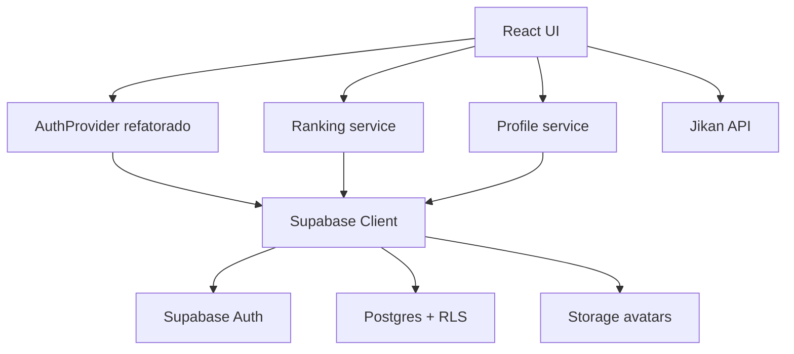

# Supabase Backend Migration Design

**Spec**: `.specs/features/supabase-backend-migration/spec.md`
**Status**: Draft

---

## Architecture Overview

A migração deve remover a dependência do backend legado do frontend e substituí-la por integração direta com Supabase Auth, Postgres e Storage. O frontend continua em React/Vite, preserva a Jikan API para descoberta e encapsula o acesso ao Supabase em módulos próprios para evitar espalhar chamadas de baixo nível pelas páginas.



### Research Baseline

Com base na documentação oficial do Supabase consultada nesta sessão:

- O cliente browser pode ser criado com `createClient(import.meta.env.VITE_SUPABASE_URL, import.meta.env.VITE_SUPABASE_PUBLISHABLE_KEY)`.
- E-mail/senha é suportado por Auth e a sessão pode ser acompanhada por eventos de mudança de estado.
- Buckets públicos não dispensam políticas de `INSERT`/`UPDATE` em `storage.objects`.
- Políticas de RLS devem usar verificação explícita de `auth.uid() IS NOT NULL` quando a regra depende do usuário autenticado.

---

## Code Reuse Analysis

### Existing Components to Leverage

| Component | Location | How to Use |
| --------- | -------- | ---------- |
| AuthProvider atual | `src/hooks/useAuth.jsx` | Refatorar para encapsular sessão Supabase em vez de `localStorage` manual |
| Rotas pública/privada | `src/routes/index.jsx` | Manter o mesmo gate, trocando a origem do estado de sessão |
| Telas de login/cadastro | `src/pages/SignIn/index.jsx`, `src/pages/SignUp/index.jsx` | Reaproveitar UI e substituir handlers |
| Telas de CRUD | `src/pages/Home/index.jsx`, `src/pages/New/index.jsx`, `src/pages/Details/index.jsx` | Reaproveitar layout e trocar acesso a dados |
| Tela de perfil | `src/pages/Profile/index.jsx` | Reaproveitar UI, trocando upload/avatar/update para Supabase |
| Integração Jikan | `src/services/jinkan.js`, `src/pages/Explore/index.jsx` | Permanecer como está, apenas preservando o fluxo até `/new/:slug` |

### Integration Points

| System | Integration Method |
| ------ | ------------------ |
| Supabase Auth | cliente browser com login, cadastro, sign-out e atualização de credenciais |
| Supabase Postgres | queries client-side com RLS para perfis, animes e tags |
| Supabase Storage | upload e leitura de avatares por bucket controlado |
| Jikan API | integração externa mantida, sem passar por Supabase |

---

## Components

### Supabase Client Bootstrap

- **Purpose**: centralizar URL, publishable key e criação do cliente Supabase.
- **Location**: `src/services/supabase.js`
- **Interfaces**:
  - `getSupabaseClient(): SupabaseClient` - retorna instância única do cliente.
  - `assertSupabaseEnv(): void` - falha cedo quando variáveis obrigatórias estiverem ausentes.
- **Dependencies**: `@supabase/supabase-js`, `import.meta.env`
- **Reuses**: padrão atual de clients em `src/services/api.js` e `src/services/jinkan.js`

### Auth Session Provider

- **Purpose**: adaptar o estado global do app para a sessão Supabase.
- **Location**: `src/hooks/useAuth.jsx`
- **Interfaces**:
  - `signIn({ email, password })`
  - `signUp({ name, email, password })`
  - `signOut()`
  - `updateProfile({ profile, password, avatarFile })`
- **Dependencies**: Supabase Auth, Profile service, Storage service, Snackbar state
- **Reuses**: API pública atual de `useAuth` para minimizar churn nas páginas

### Ranking Service

- **Purpose**: concentrar leitura e escrita de animes e tags no Supabase.
- **Location**: `src/services/ranking.js`
- **Interfaces**:
  - `listAnimeEntries(searchText)`
  - `getAnimeEntry(id)`
  - `createAnimeEntry(payload)`
  - `updateAnimeEntry(id, payload)`
  - `deleteAnimeEntry(id)`
- **Dependencies**: Supabase Postgres, sessão autenticada
- **Reuses**: contratos usados hoje em `Home`, `New` e `Details`

### Profile Service

- **Purpose**: separar atualização de perfil do ciclo de autenticação.
- **Location**: `src/services/profile.js`
- **Interfaces**:
  - `getProfile(userId)`
  - `upsertProfile(profilePatch)`
  - `uploadAvatar(userId, file)`
  - `getAvatarUrl(path)`
- **Dependencies**: tabela `profiles`, bucket `avatars`
- **Reuses**: fluxo atual de avatar/perfil em `src/pages/Profile/index.jsx`

### Supabase Schema and Policies

- **Purpose**: versionar banco, políticas e storage necessários para o app.
- **Location**: `supabase/` e `docs/supabase/` durante a implementação
- **Interfaces**:
  - migrations SQL para schema e RLS
  - documentação de auth settings e buckets
- **Dependencies**: projeto Supabase, convenção de versionamento do time
- **Reuses**: nenhum artefato atual no repositório; é uma nova fundação

### Operational Docs

- **Purpose**: sustentar setup, deploy, validação, cutover e suporte.
- **Location**: `.specs/features/supabase-backend-migration/runbook.md` agora; `docs/supabase/` após implementação
- **Interfaces**:
  - checklist de ambiente
  - checklist de rollout/rollback
  - troubleshooting por domínio
- **Dependencies**: decisões de HITL e configuração real do projeto Supabase
- **Reuses**: baseline de projeto em `.specs/project/*`

---

## Data Models

### Profile

```typescript
interface Profile {
  id: string
  full_name: string
  avatar_path: string | null
  updated_at: string | null
}
```

**Relationships**: `profiles.id` referencia `auth.users.id` em relação 1:1.

### AnimeEntry

```typescript
interface AnimeEntry {
  id: string
  user_id: string
  title: string
  description: string | null
  rating: number
  created_at: string
  updated_at: string
}
```

**Relationships**: pertence a um usuário autenticado e se relaciona com múltiplas tags.

### AnimeTag

```typescript
interface AnimeTag {
  id: string
  anime_entry_id: string
  user_id: string
  name: string
  created_at: string
}
```

**Relationships**: muitas tags por anime; cada linha continua vinculada ao usuário para simplificar RLS.

### Frontend View Model

```typescript
interface RankedAnimeView {
  id: string
  title: string
  description: string | null
  rating: number
  updated_at: string
  tags: Array<{ id: string; name: string }>
}
```

**Relationships**: é o shape que preserva os componentes `RankingCard` e `Details` com pouca mudança visual.

---

## Error Handling Strategy

| Error Scenario | Handling | User Impact |
| -------------- | -------- | ----------- |
| Credencial inválida | converter erro Auth em mensagem de login clara | usuário permanece na tela de login |
| Sessão expirada | limpar estado autenticado e redirecionar para `/` | usuário precisa autenticar novamente |
| RLS bloqueando query | registrar erro e mostrar feedback tratável na tela afetada | evita falha silenciosa |
| Upload de avatar negado | manter avatar anterior e informar falha | perfil continua consistente |
| Jikan indisponível | manter fluxo autenticado intacto e mostrar erro apenas em Explore | impacto limitado à busca externa |

---

## Tech Decisions

| Decision | Choice | Rationale |
| -------- | ------ | --------- |
| Origem do backend | acesso direto do frontend ao Supabase | reduz dependência do backend legado e simplifica a arquitetura alvo |
| Segurança de dados | RLS por `auth.uid()` | publishable key no browser só é aceitável com isolamento real no banco |
| Avatar | armazenar `avatar_path` e derivar URL via Storage | evita acoplamento a URL fixa de backend |
| Compatibilidade de UI | manter shape adaptado no service layer | reduz refactor nas páginas atuais |
| Organização de schema | versionar migrations e políticas como código | documentação e infra precisam ficar rastreáveis no repositório |

## Design Notes and Risks

- A convenção de diretórios `supabase/` para migrations e configuração é uma inferência baseada na prática padrão do ecossistema Supabase; confirme com o time antes da implementação se desejarem outra organização.
- A troca de `localStorage` manual para sessão Supabase precisa preservar o comportamento do gate atual em `src/routes/index.jsx`.
- O app hoje usa mutação direta e tratamento inconsistente de erro; a migração é uma oportunidade para corrigir isso na camada de integração em vez de replicar a fragilidade.
